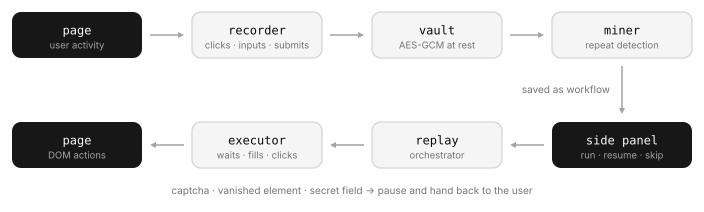

# Automated Web

[](https://github.com/arsenstorm/automated-web/actions/workflows/validate.yml)
[](https://scorecard.dev/viewer/?uri=github.com/arsenstorm/automated-web)

A local-first browser extension for workflow automation.

It passively observes your browsing, mines repeated flows on-device, and
suggests them as workflows. It replays them step by step, and it pauses and
hands control back whenever it cannot proceed safely. Everything stays in
your browser: no server, no analytics, encrypted at rest.

<picture>
  <source media="(prefers-color-scheme: dark)" srcset=".github/architecture-dark.svg">
  
</picture>

<!-- demo video goes here -->

## How it works

**Capture.** A content script buffers navigations, clicks, input changes, and
form submits in every frame of every page you visit (re-edits of the same
field collapse into one event). The buffer flushes to the background every
five seconds and on page hide. The background encrypts the events before it
stores them.

**Mining.** Once a minute, an alarm splits the event stream into per-origin
sessions (a session ends on an origin change, a 60-second idle gap, or a
return to the page the flow started on). The miner cuts each session at form
submits, the natural end of a task, and fingerprints it by its *action
shape*: origins, pathnames, and selectors only, never input values. When the
same shape repeats often enough (3× by default, configurable), a toast on
that origin offers to save it as a workflow. You can dismiss a suggestion
once or mute it per-site. Everything happens on-device.

**Recording.** You do not have to wait for the miner. A record button cuts a
workflow from what you do. Recording starts in the active tab and follows
the tabs you open from it.

**Replay.** The background orchestrator reuses the active tab when it is
already on the start URL, or opens a new one. It waits for loads and drives
the page one step at a time through the content-script executor. Steps that
open, switch, and close tabs replay too. The orchestrator persists the run
state between steps. The side panel shows live progress, and a
service-worker restart can never lose track of a run.

## Security model

- **Local-only.** No server, no telemetry, no analytics. The Firefox build
  declares [`data_collection_permissions: none`](./wxt.config.ts).
- **Encrypted at rest.** Recorded events, mined patterns, and saved workflows
  are AES-GCM-256 encrypted in `storage.local` ([`lib/vault-crypto.ts`](./lib/vault-crypto.ts)).
- **Locked means dormant.** While the vault is locked, nothing records,
  mines, or runs. A run that reaches an input step mid-lock pauses. It does
  not type into the page.
- **Secrets are opt-in.** By default, the recorder redacts password and
  credit-card values before they leave the page, and replay pauses for you
  to type them.
- **Reset is a real escape hatch.** You cannot recover a forgotten password.
  A vault reset wipes everything encrypted under it.

### Permissions

| Permission      | Why                                                        |
| --------------- | ---------------------------------------------------------- |
| `<all_urls>`    | Passive capture runs wherever you browse. Also grants the `tab.url` reads that tab matching needs |
| `storage`       | Encrypted workflows/events/patterns, plus settings          |
| `alarms`        | Periodic mining while the service worker sleeps             |
| `notifications` | "Workflow stuck / finished" alerts                          |
| `scripting`     | Injects the recorder into tabs already open at install      |
| `sidePanel`     | The UI lives in the side panel                              |
| `webNavigation` | Maps recorded frame URLs to live frame ids at replay        |

## Reliability model

The replayer's rule is **pause, never guess**:

- The executor polls for each element (every 200 ms, 10-second budget). A
  MutationObserver cannot see into shadow roots, so polling it is.
- Selectors prefer stable attributes (`id`, `data-testid`, `name`,
  `aria-label`) and reject machine-generated ids. Only then do they fall
  back to a short positional path. Selectors cross shadow boundaries with
  `>>>`. For clicks, the recorded text is ground truth: if a positional
  selector drifts onto the wrong element, replay rescues it with a unique
  text match instead of clicking the wrong thing.
- Inputs go through the native value setter so React-controlled forms see
  the change.
- Timeouts, captchas, and secret fields pause the run with a reason. The
  side panel offers resume and skip, and a desktop notification pings you.
- A service-worker restart mid-run pauses the run instead of risking a
  double-executed step.

## Known limitations

Deliberate prototype edges, roughly in priority order:

- Shadow DOM has edges: replay cannot enter closed shadow roots, and the
  click text-rescue does not search inside shadow roots.
- One run at a time.
- Pattern matching is exact-fingerprint. Reordered or slightly-varied flows
  count as different patterns (fuzzy/LCS matching is the noted upgrade path).
- No semantic or AI target matching: this is a deterministic automation
  substrate, not an agent.

## Development

```sh
bun install
bun run dev          # start dev, then load .output/chrome-mv3 as unpacked
bun run dev:firefox  # same, for Firefox
bun run build        # production build (build:firefox for Firefox)
bun run zip          # package for the store
```

## Scripts

| Script            | Description                          |
| ----------------- | ------------------------------------ |
| `bun run check`   | Lint + format check (Ultracite)      |
| `bun run fix`     | Auto-fix lint/format                 |
| `bun run compile` | TypeScript typecheck                 |
| `bun run test`    | Unit tests (Vitest)                  |
| `bun run build`   | Build the extension                  |

## Contributing

See [`CONTRIBUTING.md`](./CONTRIBUTING.md). Security issues: [`SECURITY.md`](./SECURITY.md).

## License

[MIT](./LICENSE)
